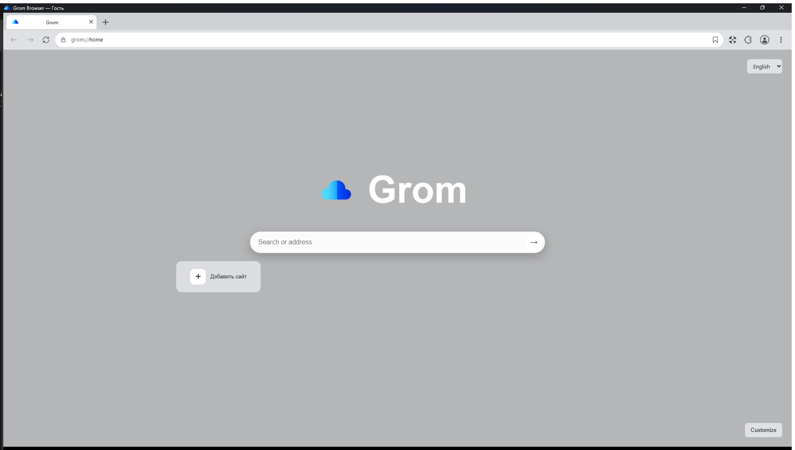

# Grom Browser

[](https://www.microsoft.com/windows)
[](https://www.python.org/)
[](LICENSE)

A Windows desktop browser built with Python, PySide6, Qt WebView, and Microsoft Edge WebView2.

**Current release:** 1.1.1  
**Developer:** Ilyin Nikita Nikolaevich N8  
**Интерфейс:** English and Russian

<p align="center">
  
</p>

## Overview

Grom Browser combines everyday browsing tools with configurable privacy controls and optional site enhancements. The first-run welcome flow starts in English; choose English or Russian there. The selected interface language is saved for the profile.

## Features

### Browsing and workspace

- Tabs, tab search, tab groups, optional vertical tabs, and split-screen browsing.
- Restore a previous browsing session and reopen recently closed tabs.
- Bookmarks, browsing history, downloads, page search, zoom, and reader mode.
- Separate browser profiles and guest/private browsing modes.

### Start page and appearance

- Customizable start page with shortcuts to favorite websites.
- Choose a theme, accent color, and optional background image.
- Configure browser controls and layout from settings.

### Privacy and site controls

- Built-in ad and tracker filtering with optional strict filtering, custom filters, and an allowlist.
- Optional cookie-banner handling and link cleanup.
- Per-site controls for camera, microphone, notifications, location, pop-ups, clipboard, and autoplay permissions.
- Optional password saving and autofill using Windows Credential Manager.

### Optional built-in site enhancements

Enable or disable tools from the browser's extensions menu:

- **Grom YouTube Enhancer:** adjust the YouTube page, hide selected sections such as Shorts, comments, live chat, recommendations, or end screens, and show a local video insights panel.
- **Grom Twitch Enhancer:** optional channel-points automation, compact chat, chat controls, stream information, and other Twitch page adjustments.
- **Grom FACEIT Enhancer:** highlight match/player statistics, adjust player cards, and optionally accept a found match automatically.
- Other tools include an audio equalizer and volume boost, video speed controls, and controls for automatic media playback.

Site-specific behavior can change when third-party websites update.

### Tools and customization

- Page translation, screenshots, developer tools, and site information.
- Download controls, including optional concurrency and speed limits.
- Performance settings such as memory saving and hardware acceleration.
- Windows app icon and executable version metadata.

## Download and install

Download the latest Windows installer from [GitHub Releases](https://github.com/N8v1/Grom-Browser/releases/latest):

1. Download `Grom-Setup-*.exe`.
2. Run the installer and follow the setup steps.
3. Start Grom Browser from the Start menu or desktop shortcut.

**Requirements:** Windows 10/11 (64-bit) and Microsoft Edge WebView2 Runtime. If WebView2 is missing, install the [Evergreen WebView2 Runtime](https://developer.microsoft.com/microsoft-edge/webview2/).

## Build from source

Build on Windows with Python 3.10 or newer. Open PowerShell in the repository folder (the folder containing `build_gui.py`).

Install dependencies:

```powershell
python -m pip install -r requirements.txt
```

Start the graphical builder:

```powershell
pythonw build_gui.py
```

Click **Build application**. The application folder is created at `dist/Grom/`; run `dist/Grom/Grom.exe`. Copy the entire `dist/Grom/` folder when moving the app to another computer.

### Build the installer

Install [Inno Setup 6](https://jrsoftware.org/isinfo.php), open `GromInstaller.iss` in Inno Setup Compiler, and select **Compile**. The installer will be written to `installer_output/Grom-Setup-1.1.1.exe`.

You can also compile it from PowerShell:

```powershell
& "C:\Program Files (x86)\Inno Setup 6\ISCC.exe" .\GromInstaller.iss
```

## Project structure

| File | Purpose |
| --- | --- |
| `grom_browser.py` | Application entry point and main browser window |
| `webview.py`, `tabs.py` | Web view, tabs, and browser workspaces |
| `downloads.py`, `profiles.py` | Downloads, profiles, and credential integration |
| `internal_pages.py` | Welcome, start, settings, and downloads pages |
| `builtin_extensions.py` | Built-in privacy and site enhancements |
| `i18n.py`, `ui_translations_en.json` | Interface localization |
| `build_gui.py` | Graphical PyInstaller builder |
| `GromInstaller.iss` | Inno Setup installer definition |

## License

Grom Browser is distributed under the GNU General Public License v3.0. See [LICENSE](LICENSE).

## Русский

**Grom Browser** — настольный браузер для Windows на Python, PySide6, Qt WebView и Microsoft Edge WebView2. Интерфейс доступен на русском и английском языках. Первый запуск начинается с приветственного экрана на английском: язык можно выбрать там, и он сохранится в профиле.

### Возможности

- Вкладки, поиск по вкладкам, группы вкладок, вертикальные вкладки и разделение окна для просмотра двух страниц.
- Восстановление прошлой сессии и недавно закрытых вкладок.
- Закладки, история, загрузки, поиск по странице, масштабирование и режим чтения.
- Несколько профилей, гостевой и приватный режимы.
- Настраиваемая стартовая страница с быстрыми ссылками, темами, акцентным цветом и фоновым изображением.
- Встроенная фильтрация рекламы и трекеров, строгий режим фильтрации, собственные фильтры и список исключений.
- Управление разрешениями сайтов для камеры, микрофона, уведомлений, местоположения, всплывающих окон, буфера обмена и автозапуска медиа.
- Необязательное сохранение и автозаполнение паролей через защищённое хранилище Windows.
- Дополнительные инструменты для YouTube, Twitch и FACEIT, включаемые через меню расширений.
- Эквалайзер и усиление звука, изменение скорости видео и управление автовоспроизведением.
- Перевод страниц, снимки экрана, инструменты разработчика, информация о сайте и настройки производительности.
- Настройки загрузок, включая число одновременных загрузок и ограничение скорости.

Поведение встроенных инструментов для YouTube, Twitch и FACEIT зависит от изменений на этих сторонних сайтах.

### Скачать и собрать

Последний установщик Windows доступен на странице [GitHub Releases](https://github.com/N8v1/Grom-Browser/releases/latest). Нужны Windows 10/11 (64-разрядная версия) и Microsoft Edge WebView2 Runtime.

Для сборки исходников установите Python 3.10+, выполните `python -m pip install -r requirements.txt`, запустите `pythonw build_gui.py` и нажмите **Build application**. Папка программы появится в `dist/Grom/`.

Для создания Setup установите Inno Setup 6, откройте `GromInstaller.iss` и нажмите **Compile**.

### Лицензия

Проект распространяется по GNU General Public License версии 3. См. файл [LICENSE](LICENSE).
